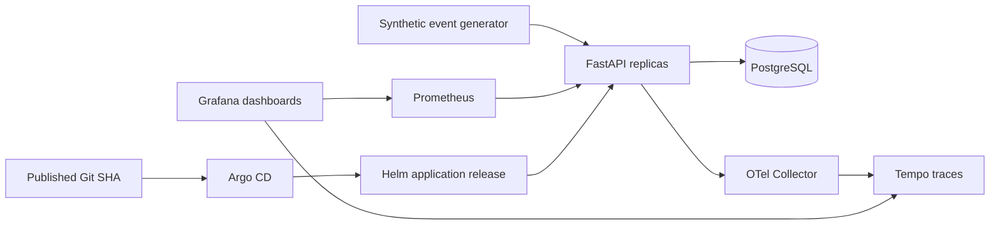

# Architecture and ownership

G1 is a single-workstation reliability lab with synthetic data, two API replicas,
and one persistent PostgreSQL instance. It is not a highly available database or
a multi-AZ environment. All Kubernetes commands select the dedicated kubeconfig
and `kind-financial-showcase` context; the user's default context is untouched.

## Decisions

1. **Small application, observable transactions.** An event insert, idempotency
   check, and optional incident insert share a database transaction. A unique
   constraint arbitrates concurrent requests. Reusing a key with a different
   payload returns conflict. Only the fixed synthetic message catalogue is accepted.
2. **One deployment owner.** Direct Helm is a development mode. Once Argo owns the
   release, changes flow from a published immutable Git SHA. Terraform owns AWS
   foundations, not these application objects. No resource is managed by both.
3. **Current supported compatibility.** Kubernetes 1.36.4 is selected for the
   tested intersection of kind, Calico, and Argo CD. The latest Kubernetes major
   is not automatically the correct combination. Sources and digests are recorded.
4. **OpenTelemetry first.** FastAPI native tracing exports OTLP to the Collector.
   Tempo stores local traces. Future AWS export uses OpenTelemetry rather than
   the legacy X-Ray SDK/daemon. Metric labels use route templates and bounded
   method/status values, never transaction or incident IDs.
5. **Credentials stay local.** Generated API/database/Grafana secrets are ignored,
   files have restrictive permissions, and credentials are never embedded in
   dashboards, charts, Terraform outputs, or published evidence.

## Security controls

- Calico enforces default-deny policies; explicit paths cover DNS, API-to-database,
  metrics scraping, and OTLP. The E2E suite tests allowed and denied connections.
- Workloads have resource requests/limits, restricted pod security, non-root users,
  dropped capabilities and read-only application filesystems. PostgreSQL uses
  persistent writable data and a non-superuser application role.
- Migration checksum validation and an advisory lock prevent concurrent schema
  changes from silently diverging. Readiness checks the database; liveness does not.
- API auth is a local internal-service bearer token, not a customer identity
  platform. There is no internet ingress, TLS termination, or multi-tenant promise.
- Atlantis has an isolated network, no AWS credentials, kubeconfig or Docker socket,
  trusted read-only server configuration, and an explicit plan/version-only command
  allowlist. Fake VCS placeholders are not credentials or a verified integration.

## AWS boundary

The foundation represents segmented subnets in two AZs, a private encrypted S3
evidence bucket and restricted IAM access. Tests use mocked AWS providers with no
remote backend, API requests or deployment. Subnet layout alone does not prove
Multi-AZ resilience. EKS/EC2, RDS, load balancing, autoscaling and cloud observability
belong to later milestones with account, region, cost and teardown decisions.

Local data recovery is tested by dump/restore into a separate database. This does
not establish RDS PITR, a cloud RPO/RTO, or disaster recovery across regions.

## G2-A: state bootstrap before cloud runtime

The separate [state-bootstrap root](../infra/state-bootstrap/README.md) has no
active backend and defaults to zero resources. Its secret-bearing state bucket
must be separate from the synthetic reports bucket. It emits an inactive backend
contract and a narrowly scoped, unattached policy for one default-workspace key
and its deletable lock. No identity, trust relationship or policy grant is created.
Cloud activation still requires a separately approved account, budget and custody
procedure; the bootstrap cannot initially depend on the bucket it has not created.

Atlantis may authorize a repository identity before it knows a project. That first
step does not authorize execution: its later project check must match both the
foundation name and exact directory. Bootstrap and unknown projects are denied;
directory allowlisting does not sandbox untrusted Terraform providers or sources.
